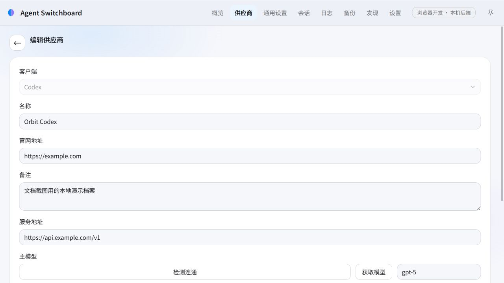
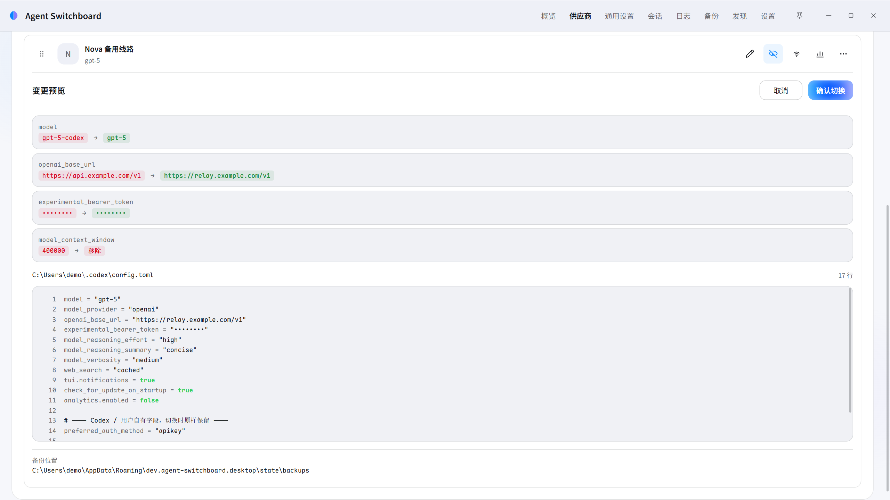
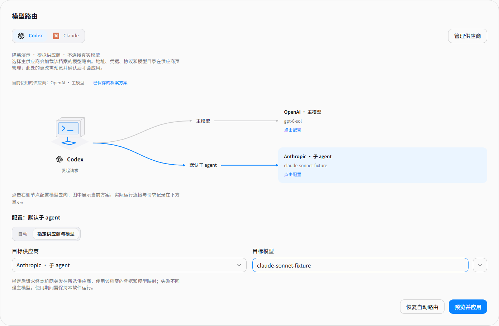

<p align="center">
  
</p>

<h1 align="center">Agent Switchboard</h1>

<p align="center">
  A local configuration console for <strong>Codex</strong> and <strong>Claude Code</strong>.<br>
  Manage providers, preview configuration changes, recover from switches, and track usage and probe history.
</p>

<p align="center"><sup>English · <a href="README.zh-CN.md">简体中文</a></sup></p>

Save models, connection details, and runtime parameters as provider profiles, then inspect the files and changes before switching. Client settings, Skills, MCP, session records, and usage monitoring share one desktop app.

## Download and install

Download an installer for your system and processor from [GitHub Releases](https://github.com/y4Nkk/agent-switchboard/releases). The table lists the project's packaging platforms; check the selected release's Assets for available files. This README describes the current source; consult the corresponding release notes for features in a published version.

| Platform | File to choose | Installation |
| --- | --- | --- |
| Windows x64 | `*windows-x86_64-nsis.exe` | Run the wizard; the default NSIS version installs for the current user with a selectable directory |
| macOS Apple Silicon | `*aarch64*.dmg` | Open the disk image and drag the app into Applications |
| macOS Intel | `*x86_64*.dmg` | Open the disk image and drag the app into Applications |
| Linux x64 | `*x86_64*.deb` or `*x86_64*.AppImage` | Use a package installer on Debian/Ubuntu; grant an AppImage execute permission before running it |

The custom Windows installer requires .NET Framework 4.8.1. The app requires Microsoft Edge WebView2 Runtime; the installer attempts to download and install it when missing. The Linux `.deb` depends on WebKitGTK 4.1. `Source code` archives are for development; `.sig`, `latest.json`, and updater archives belong to the update process.

## First use

Install and configure the Codex or Claude Code client you want to use, and have your provider URL, authentication details, and model names ready. Degradation radar also requires an executable local Codex CLI.

1. Create a profile in **Providers**, or import existing local configuration.
2. Set its protocol, authentication, and model. Use **Client configuration** to adjust shared settings, sub-agent runtime settings, and global instructions as needed.
3. Preview the switch, review the redacted diff, target files, and backup location, then confirm. Switching preserves configuration keys outside the profile's ownership.
4. After using the client, check consumption and quotas in **Usage**, and local conversations in **Sessions**.
5. To undo a configuration change, open **Settings → Backups → Local backups** and restore the corresponding record.

Missing configuration, syntax errors, and external edits surface specific explanations. Errors whose meaning cannot be established are never silently overwritten.

Client configuration follows the current [Codex configuration reference](https://learn.chatgpt.com/docs/config-file/config-reference) and [Claude Code settings reference](https://code.claude.com/docs/en/settings-reference). Codex terminal screen and resume-directory modes use strings; notifications accept a boolean or event-name list. Provider parameters include service tier and compaction thresholds. Claude parameters include compaction window, fast mode, request timeout, and output limit; shared preferences include response language and memory directory.

Claude persistent reasoning effort is edited per model under **Provider → Runtime parameters**, using `modelSettings.<model>.effortLevel` with `low`, `medium`, `high`, or `xhigh`. It uses the existing profile fragment and leaf ownership manifest. Gateway projection maps upstream model identifiers to client roles; stopping takeover restores the previous route's declared model preferences. Shared extra configuration uses literal client model identifiers and cannot overwrite an active profile's claimed paths. The retired user-level top-level `effortLevel`, per-model effort `max`, Codex boolean terminal modes, and `approval_policy="untrusted"` are rejected; no value is guessed or converted. Existing invalid stored values require explicit correction. Writes remain previewed, confirmed, backed up, and recoverable.

## Interface preview

These screenshots show the frontend from the **local 0.3.3 production build**, captured on **October 14, 2026** with mock data in an isolated headless browser. OpenAI and Claude provider profiles, balances, usage, and probe records are demonstrations, not measurements of real services. Demo model identifiers include `gpt-6.1-sol`, `gpt-6-astra`, `gpt-6-luna`, and `claude-sonnet-5-5`. Capture does not contact model services or read personal configuration or credentials. The screenshots show the Chinese interface. See the [screenshot data notes](docs/screenshots/README.md) for sources and capture boundaries.

**Provider overview** — See the active Codex and Claude Code connections, manage profiles, and check balances.



**Switch preview: review changes before applying**

Inspect changes to models, endpoints, and runtime parameters, together with the target configuration file and backup location.



**Client configuration: sub-agents and terminal settings**

Set sub-agent availability and concurrency, and manage terminal screen and resume-directory preferences.


**Usage: model shares and daily trends**

Review input, cached, and output tokens by time range, with a model breakdown, daily trends, and session counts.


**Degradation radar: batch results and individual runs**

Review pass counts, token consumption, reasoning tokens, final answers, and duration for each run. The pictured results are simulated.

Probes keep running when you switch pages or minimize the window. Completion, cancellation, failures, and unsaved results appear in the titlebar's global information area. Exiting the app stops the probe.


**Probe history: filter by time, profile, and status**

Browse the configuration, question, pass count, and consumption recorded for each batch, then open its details.


**Local gateway: protocol topology and request status**

Inspect the loopback address, protocol translation paths, request counts, failures, and latency distribution.


**Graphical model routing: client → purpose → provider and model**

Select a destination node to configure the main model, Codex default sub-agent, or Claude model tier, then preview and confirm. This isolated demonstration uses simulated providers and models.



## Core features

| Location | What you can do |
| --- | --- |
| Providers | Create, edit, reorder, import, and delete profiles; manage models, authentication, protocols, model mappings, and runtime parameters; diagnose configuration and connections, preview repairs and undo them; export provider SQL files |
| Model routing & gateway | Configure main models, default sub-agents and Claude tiers graphically; preview and apply, then inspect actual connections and recent requests |
| Client configuration | Manage shared settings, Codex sub-agent runtime settings, and global instructions; preview and apply drafts, including controlled edits to fields outside the regular form |
| Extensions | Manage Skills and MCP with per-client enable/disable, search, updates, import/export, local discovery, and advanced management |
| Sessions | Full-text search and message navigation, project groups, pins, tags, local aliases, time filters, and bulk organization; resume or delete sessions, export Markdown, and save prompts or answers as snippets |
| Usage | Inspect consumption, quotas, reset times, and local coding-process resources; run degradation radar and browse probe history |
| Settings → Client tools | Save and restore Codex work scenarios; manage Claude client integration |
| Settings → Preferences | Follow the system, Simplified Chinese, or English for the interface; select 90%, 100%, 110%, or 125% interface scale, record a global shortcut, and choose the startup page |
| Settings → Diagnostics | Inspect configuration or environment issues and runtime logs |

**Interface language.** The whole desktop app — main window, tray panel, notifications, dialogs, and app-owned error explanations — ships in Simplified Chinese and English. The preference offers 跟随系统 / 简体中文 / English and is saved like every other application preference: switching applies to the main window and tray immediately, survives a restart, and never touches user content (provider names, session text, configuration originals, and third-party diagnostics stay verbatim). A fresh install follows the system locale — a Chinese desktop gets Simplified Chinese, everything else gets English — while an existing installation upgraded from an earlier release keeps Chinese. Dates, numbers, and quota window names follow the chosen language with identical precision and business meaning.

Codex work scenarios save combinations of existing providers, extensions, and instructions, with a change preview before restoration. The global shortcut shows and focuses the main window, or hides it to the tray when already focused. Startup can open the provider list or the last visited top-level page, without restoring editing drafts. The sidebar remembers its expanded or collapsed state across restarts; it expands on first use. Each change is saved before the layout switches. Unreadable sidebar state offers a reload action without overwriting the record. Unreadable preferences require explicit repair, which resets only application preferences.

Provider switches and configuration draft writes require preview and confirmation, with backup and recovery. Extension operations apply immediately by default; sensitive connection data, deleting definitions with existing installs, and disabling a Claude project-shared Skill require extra confirmation.

**Deploy & diagnose** applies matching operations to multiple targets of one extension in an atomic plan. Updates explicitly skip Skills pinned to older content; unpinning shows whether deployment is pending. MCP checks independently select a client or project target and run the current library configuration in that target's working directory, honoring Codex's explicit directory setting. Checks use standard initialization and read advertised capability directories without calling tools. Closing management cancels the check; completion refreshes the list. Results are saved per target and definition revision and do not establish that the native client is connected. Dedicated SSE/WebSocket transports and interactive authorization require native-client verification.

### Session search and saved snippets

Session search reads Codex's native history database, active and archived rollout fragments, and Claude Code's main and subagent transcripts. A logical session keeps all continuation fragments; repeated observations are deduplicated. Readable text, reasoning, tools, agent messages, images, and other structured content share the same search, detail, copy, snippet, and export reader. Encrypted or missing originals remain explicitly identified. Search covers message bodies, titles, summaries, project paths, and session IDs, ignoring case and collapsing whitespace. Opening a result locates the original message; changed or removed messages are reported. Unreadable records and incomplete trailing writes are reported alongside available content.

Session metadata and message positions are indexed in the rebuildable `state/sessions/read-index.sqlite3` store. Unchanged sources reuse their index; message pages decode only the selected messages and full content seeks directly to its source record. Search pagination reuses the latest query for each unchanged session. Consumption shares one set of indexed call facts across all date ranges; changed sources are revalidated and appended records are decoded incrementally after their existing byte prefix is verified. Native client databases remain read-only.

Export Markdown uses the system save dialog and includes the complete readable transcript and source metadata. Save a user or assistant message to keep an independent local snapshot in **Saved snippets**, where it can be searched, read, copied, removed, or opened in its source conversation. Deleting a session does not delete its saved snippets. These snapshots live in `state/sessions/collections.sqlite3` inside the app data directory and are not included in provider exports or cloud backups. A damaged or unexpected collection database is reported and preserved, never silently reset.

Claude sessions belong to local projects across account switches. While the app is running, it preserves complete records, subagents and referenced local attachments in `state/sessions/claude.sqlite3` at startup, every 10 seconds, before confirmed Claude switches or login replacement, and on normal exit. Rewritten logs retain their previous complete versions. Reading, search, copying, export and consumption use this library; missing originals do not remove saved sessions. **Claude session sources** connects other accounts’ configuration folders and displays source problems; disconnecting a folder keeps saved sessions. Data deleted before the app first observed it, or changes made while the app is closed, cannot be guaranteed preserved. The **Sessions** page offers bulk cleanup by date: it deletes the selected preserved Claude sessions including the original session records in the client directory, with a preview before an explicit confirmation, and compacts the library afterwards; Codex sessions are not affected.

Resume reconstructs a managed transcript with its available attachments, uses the current account and opens the original project when it still exists. Resuming a Claude subagent opens its parent session. Resume files are tracked for further preservation and removed with the session. Explicit Claude deletion removes reachable originals and saved records and prevents offline copies from being imported again; independent snippets and workflow conversions remain. Registered Codex history is read-only here; delete those sessions in Codex. This does not rewrite Claude Desktop’s account list or synchronize cloud history.

Claude workflow journals are execution events, separate from conversation transcripts and token receipts. Background discovery automatically saves every JSON event in an application-owned record under `state/sessions/converted`, preserving order, fields, timestamps when present, and the parent conversation. Changed journals refresh the same record; broken or changing journals retain the previous complete copy. Originals stay unchanged. Search, reading, copy, snippets, and export share the conversation reader; resume opens the parent conversation. Deleting a converted copy records that choice so background recovery will not recreate it.

Codex discovery reads both JSONL and Zstandard-compressed `.jsonl.zst` archives. Source changes receive a bounded retry, and outdated or invalid derived index entries rebuild automatically. Codex and Claude source diagnostics stay in runtime logs and relevant read results; they do not publish global notifications. Message offsets refer to decoded records, and paged reads reuse a streaming decoder without keeping another full transcript.

Session and consumption notices share **Acknowledge and close**, with a compact entry to review acknowledged notices. Acknowledgement lasts for the current mounted workspace and applies only to those notices; new problems remain visible. Closing a notice does not change data coverage or usage totals. Workflow events and their converted copies never add usage calls or inflate session coverage counts.

Group sessions by client and project, filter by last activity, tags, or pinned status, and open a search result's project directly. Pins, tags, and local aliases are stored in `state/sessions/organization.sqlite3` inside the app data directory; client transcripts stay unchanged. Bulk actions pin, unpin, add tags, or remove tags. Filtering and sorting happen before pagination, and page selection deduplicates sessions.

Conversation details paginate messages; saved snippets are searched and paginated on the backend and return previews. Expanding an entry loads its content on demand. Long content uses pages of source text, search opens the content page containing the match, and the outline covers the current message page. Full-message copying reads content only when requested; preview and page copying have separate labels. Hidden session workspaces release content and lists while retaining selection, message and content pages, expansion, reading position, and edit state. Markdown export streams records to the chosen file and preserves an existing destination on failure. Individual session records and collection reads have a 32 MiB resource limit; oversized records produce an explicit error.

### Storage and cache

Successful provider and official quota readings append to `state/usage-history.sqlite3` without age or point-count pruning. Startup imports an existing `usage-history.json` transactionally once and moves the original into `state/repair-backups/`; runtime has one SQLite owner. Saving or deleting a provider does not erase its history. Charts sample at most 720 actual points across the full retained span and disclose the original count and time bounds. Current provider-query and official-account scopes remain separate.

**Settings → Storage and cache** shows application data, configuration recovery backups, archivable history, and browser cache usage. On Windows, resource and code caches are checked at startup and every 5 minutes and reclaimed through the WebView2 disk-cache API above a 64 MiB threshold. Manual clearing is also available. Usage can exceed the threshold between checks. Sign-in state, preferences, and business data are retained.

History archival previews a cutoff and record count, then saves a complete `.jsonl.gz` archive outside application data. The archive covers this app's configuration-write history only; only after the archive is durable are matching older records reclaimed, and unused database pages are compacted when appropriate. Codex request details and radar probe records are not reclaimed through the storage section (radar record deletion belongs to the radar page). The current UTC billing month and each client's latest configuration recovery record are retained. History changes invalidate the preview, and incomplete reclamation is reported separately while preserving the archive. These histories are archived explicitly, with no default age-based deletion.

Backup cleanup lives in **Settings → Backups → Cleanup**: whole recovery-backup groups (including the paired client-settings snapshots and linked Codex auth backups) are exported as a `.tar.gz` archive outside application data for the chosen date, and local copies are deleted only after the export verifies. Each client's newest backup group is always retained, and cleanup is refused while a configuration transaction is pending.

### Provider diagnostics and repair

Open a saved provider's details and select **Diagnose**. Local checks cover the endpoint, protocol, authentication configuration, model, environment variables, client configuration, and gateway routing. Environment checks report variable names and their inspection scope without exposing secret values. Manually run connectivity checks or real model requests to verify the upstream service; model requests may consume provider quota. Direct upstream tests do not verify the client's complete path through the gateway.

Codex requests read the specialized saved provider file and resolve its default model through the saved upstream mapping. A changed profile or managed account identity invalidates a prepared request. Gateway diagnostics read listener, configured port, client endpoint, and route facts independently, including when a repair plan cannot be generated.

Configuration repair applies only to the currently active saved profile. Review the changes before confirming; profile-owned fields are regenerated through the existing switch executor with backup and recovery. Undo previews are tied to that repair and reject later configuration changes. Persistent backups remain available in **Settings → Backup recovery** after closing the diagnostic window. Inactive profiles, environment overrides, and upstream failures receive guidance without silently switching providers or guessing credentials.

Preview and execution share the same provider write scope, preserving live client preferences, shared fragments, and unowned content. A provider fragment that conflicts with the live shared fragment's ownership declarations is rejected without overwriting shared values.

Generated immutable model catalogs are retained; undo restores configuration and authentication. A repair that only recreates a missing catalog explains this outcome and does not offer an empty undo action.

When provider storage or egress settings fail validation, **Repair application data** checks both domains and reports repaired files, all backup paths, and any unresolved issues separately. Provider repair validates a complete staged copy before activation and retains the original configuration directory. Egress repair rechecks the current file, preserves valid settings, and backs up invalid bytes before restoring direct mode; unreadable files are left unchanged. Ambiguous provider files, retired layouts, and pending transactions are reported and preserved. This action does not clear profiles or edit live Codex or Claude Code configuration.

### Quota cache and degradation radar

**Usage → Quota & resets** lists configured Codex and Claude Code providers and their queryable remaining, used, total, and reset readings. Refresh one provider or all configured queries; failed reads retain the last successful value and its timestamp. Unconfigured queries remain unknown. Each source keeps its own unit; local token consumption never implies a monetary or subscription balance. Codex official account quota remains a separate read.

Active session logs are read through a bounded, verified byte prefix, including Claude's preserved transcripts. Normal appends do not abort consumption or discard a session; the next refresh catches up. Replacement, truncation, or rewritten records remain explicit. Sessions with no verifiable usage do not appear as measured zero consumption.

Usage reads follow the visible Consumption, Quota, Resources, or Radar tab and stop when that tab or window is hidden. Token ranges follow actual call dates in the local calendar. Codex response receipts and Claude vendor message usage own consumption; copied receipts, continuation replays and compaction checkpoints count once. Context-window estimates and inherited cumulative counters never become consumption. Undated calls appear only in All; sessions without verifiable call usage have an explicit coverage notice. A failed foreground refresh retains the same-range result and retries. Runtime logs apply the selected severity before choosing the latest 500 matches and disclose the full match count and skipped records.

**Usage → Resources** samples CPU, resident memory, and process counts for Agent Switchboard and attributable Codex/Claude Code coding engines and task children. Native Windows, macOS, and Linux collectors share one backend attribution and sampling contract; nested coding engines take ownership of their own tasks, so probes are not also counted under Switchboard. CPU is normalized to the machine's online logical processors and requires a valid interval; unreadable and warming metrics remain unknown. On Windows, resident memory is each process's private working set — the same gauge as Task Manager's Memory column — so process sums do not double-count the pages WebView2 children share; on macOS and Linux the sums include shared pages, and Linux RSS is approximate. Windows associates WebView2 processes through the application's environment; other platforms explicitly disclose incomplete interface-process coverage. The view refreshes about every two seconds while visible, with process details paged in groups of 50 and no persistent resource history. Scheduled reads update values quietly; only a manual refresh changes the refresh button. Failures retain the previous reading, timestamp, and diagnostic until a successful read. Existing table content stays mounted while hidden, avoiding recreation of expanded details and their scroll containers. Memory rings share a scale that only expands during a visible visit; the sample time includes seconds. Desktop/editor shells and whole WSL, container, or remote environments are excluded; browser development counts the native backend only.

Engine discovery verifies the running image against native launchers, desktop download locations, Claude's version directory, or the owning npm/editor package manifest and entry layout. Editor extensions can live in custom directories, and desktop engines need not appear in Switchboard's PATH. Helpers inherit a verified engine's task ancestry; a `codex-` prefix or a generic version number alone never establishes ownership. Windows joins native WTS user identities with the process topology before reading candidates; macOS enumerates the current effective user, and Linux reads the effective UID from `/proc` status. Confirmed foreign users are excluded. Unverified-user candidates disclose an enumeration limit rather than a client-specific access error; unavailable metrics remain unknown.

Provider rows keep the model on a fixed primary line and show every returned usage window below it. Balances, reset countdowns, validity, last-update time, and refresh are visible without opening the detailed table. The tray reads the same cache, shows up to two readings that fit, and marks additional readings with `+N`. Failed refreshes retain the last reading with an explicit stale label; opening either view does not trigger a network query.

Usage scripts return one reading or an array. Numeric fields are `remaining`, `used`, `total`, with `unit` (`%` for percentage readings); optional metadata is `planName`, `resetsAt` (RFC 3339 with timezone), `isValid`, `invalidMessage` (only when invalid), and `extra` (plain text). Missing numbers remain unknown. Native CC Switch import templates preserve declared reset times and percentage units; stored custom scripts are never silently rewritten.

Both query modes share HTTP validation and business normalization. Extraction returns facts; the backend produces one `availability` state per reading: `available`, `exhausted`, `unavailable` (with an optional message), or `unknown`. Zero and negative balances, consumed quotas, and explicitly unavailable plans are successful readings that replace stale balances and clear refresh errors. Missing values stay unknown. Authentication, HTTP, script execution, and malformed-data errors remain query failures. No provider names, endpoints, or error strings select a different business path, and configured extractors are always honored. Cached readings use only the normalized contract; disposable caches with the previous shape are rebuilt by the next query.

Usage details default to collapsed. The current strict preferences contract stores explicit expansions in `expandedUsageIds`; the former collapsed-id field is rejected, without compatibility reads or automatic preference rewriting. An existing preferences file in the old shape requires the application's explicit preference repair action. Disposable usage caches in an invalid shape are rebuilt by the next configured or manual query.

Provider balances and Codex official quotas refresh in the background at the interval set for each profile, including while on another page or hidden in the tray. Lists and the tray share the cache; opening a page does not trigger another query. Set the interval to `0` for manual queries only.

In **Usage → Degradation radar**, batch-test the active Codex configuration with built-in or custom questions:

- **Results:** Integer questions grade successfully completed final nonnegative integer answers. Failed, timed-out, cancelled, and interrupted runs remain unjudged. Changes to configuration or the effective route during a probe terminate the current call.
- **Time limits and progress:** The built-in counting, round-trip and seating questions each allow 3 minutes per run; the pelican HTML animation allows 15 minutes. Custom questions, including ones reused from history, allow 5 minutes for integers, 10 minutes for SVG and 15 minutes for HTML. These are waiting limits, not predicted completion times. The question shows its limit before starting; the backend also owns the allowed number of runs. Above the reference visual, a live panel shows the actual run's countdown, elapsed time, stage and completed-run count; history uses the same live progress. Preparation has an explicit stage and no countdown until the call starts. Refreshing reconnects to the backend's running clock; duplicate starts cannot reset it. A new call starts only after the preceding result is saved. Hidden pages stop polling and resync on return; failed reads mark the last reading and offer a read-only retry. Collection, saving and cancellation show elapsed time while the backend finishes. Countdown zero never declares success; progress measures completed runs rather than guessing how much content the model has generated. The current view follows the active batch even if the system clock changes. Timeout diagnostics show the applicable limit.
- **Pelican animation:** The single built-in pelican question (first in the catalog, the radar's default selection, capped to a single run) uses the HTML/SVG 2D animation prompt from the [Linux.do community experiment](https://linux.do/t/topic/2702004), with a visible requirement to return complete HTML in the final answer rather than a file path. The radar and history display the document with its inline styles and animation scripts in an isolated preview; external dependencies are blocked. Below the question, a built-in reference visual — a hand-made complete HTML animation — demonstrates one possible output; it is not a grading baseline and shares the same isolated preview pipeline as probe results. Original answers use the local history cache and remain available after refresh or restart without another model call. Assess the animation by observation; it receives no automatic pass/fail verdict. Custom questions can select SVG or HTML output. Tool-assisted community results use different generation conditions and are not controlled comparisons.
- **Consumption:** Probes make real provider calls and consume quota; their usage is included in statistics. Reasoning tokens and consumption come from that CLI session. Missing data stays unknown, and partial totals disclose their coverage. Results are reference signals and cannot establish the actual model's identity.
- **History:** Questions, expected answers, results, CLI versions, and configuration snapshots are stored locally without credentials. They remain available after refresh or restart. Profile renames and deletions do not rewrite history. An abrupt exit retains completed results and marks the batch interrupted; restarting does not resume it automatically.
- **History actions:** Filter by time, profile, or status, browse pages and details, and rerun a stored question with its answer format, expected answer and repetition count. Reruns make new calls; deletion affects radar records only. Failed result saves show the cause and block new probes and normal exit until saving succeeds.

### Sub-agent models and protocol gateway

Open the graphical workspace from a provider row's routing button or the Model routing & gateway entry in the sidebar. Choose a client and primary provider, then select a destination node to edit its model. Changing the primary provider loads that profile's saved plan; addresses, credentials, protocols and catalogs remain on Providers. Preview and confirmation save the models and activate the provider in one recoverable transaction. Claude's main model and Haiku, Sonnet, Opus and Fable tiers share the selected provider's connection.

Cancelling a preview or leaving its workspace revokes the unconfirmed plan. Cancellation failures remain visible and can be retried; confirmed transactions continue to completion. Applying a route refreshes the actual configuration and gateway status immediately.

A Codex default sub-agent model can target a model in another saved profile that is not account-bound. Requests use that target's authentication, protocol, model mapping, and runtime parameters, and usage belongs to the target. Invalid references fail explicitly, with no fallback to the main model. Referenced profiles and models cannot be deleted. Editing a target also previews and updates any affected active model catalog.

When protocol translation or sub-agent routing is needed, the app uses a gateway listening only on `127.0.0.1`. Keep the app running while using those routes.

Codex and Claude Code are the supported clients. Names such as xAI (Grok) refer to upstream model services. Saving a provider used by an active failover route previews and applies its request settings together, while keeping the primary provider selected; failures roll back through the existing save transaction.

| Client | Native upstream | Translated upstreams |
| --- | --- | --- |
| Codex (Responses) | Responses | Chat Completions, Anthropic Messages |
| Claude Code (Anthropic Messages) | Anthropic Messages | Chat Completions, Responses, Gemini |

Translation has explicit limits: fields and tools that cannot be represented losslessly fail, while some metadata affecting only metering or caching is dropped after validation. Cross-protocol Codex requests require `store=false`, with continuation context filled from local history; switching profiles or keys invalidates old encrypted continuations. Codex WebSocket connections terminate at the gateway and use HTTP/SSE upstream. Sub-agent routes support `/responses/compact` and V2 Responses compaction according to the target's capabilities; other auxiliary operations reject cross-provider model references. Claude failover follows only the policy explicitly configured in the local `claude-failover.json`.

HTTP tool-call history requires an explicit client session ID and keeps response IDs separate between sessions. Requests without a session ID must include the complete tool-call context. HTTP and WebSocket share native Responses tool-name and argument restoration.

For translated Chat requests, empty assistant turns are omitted and user messages separated by those turns are joined. Reasoning-only turns fail explicitly rather than losing their reasoning. Anthropic translation rejects root-level `anyOf`, `oneOf` or `allOf` tool schemas with the tool name; nested unions remain intact. Both clients share one Moonshot Chat schema rewrite that also covers Codex WebSocket and compaction requests while preserving existing constraints.

Configured Chat reasoning declares its thinking toggle, required `separateOutput` and effort parameter independently. `separateOutput=true` requests `reasoning_split=true` even without per-request effort; disabling thinking still requires a supported toggle or effort parameter. The old `thinkingParameter=reasoningSplit` value and configurations missing the new field are rejected without automatic conversion. Native MiniMax Chat endpoints require structured separate reasoning output. Native Azure and Bedrock Chat endpoints use `max_completion_tokens`, preserving the output budget and rejecting conflicting limits. DeepSeek thinking tool history must retain original reasoning; missing traces are never fabricated. JSON and streaming round trips distinguish an absent reasoning field from an original empty one. Encrypted continuations accept only v4 with source provenance; older continuations fail explicitly.

## Data storage and scope

Configuration, caches, sessions, probe history, and diagnostics are stored locally by default. The app manages Codex and Claude Code only, with no telemetry, application account system, automatic cloud sync, public proxy, or implicit provider switching. Network features such as model requests, quota queries, and extension downloads contact their respective services. Optional cloud backups require user setup and upload confirmation.

| Method | What it saves and restores |
| --- | --- |
| Local file backups | File backups created by configuration writes, for restoring the corresponding changes from backup records |
| Provider SQL export | Complete configuration of all provider profiles, for import within the app on another device; files may contain authentication details and should be handled as credentials |
| Encrypted cloud backup | Provider profiles, client settings, and switch records from the application's configuration store; excludes local sessions, radar history, and local file backups |

Open **Settings → Backups → Encrypted cloud backup** and follow the in-app guide to configure your own Supabase project, Publishable key, and project Auth user. A separate backup password encrypts the backup on this device before upload. Each upload replaces that account's existing cloud backup. Login and backup passwords are not persisted; restoration requires the original backup password.

Cloud restoration replaces the application's provider profiles, client settings, and switch records. It does not directly change the active Codex / Claude Code configuration or delete local file backups. Activating a restored profile still requires a preview and confirmed switch.

## Development and builds

### Prerequisites

Use the Node.js version pinned in [.node-version](.node-version), npm, and Rust. See the [Tauri platform prerequisites](https://v2.tauri.app/start/prerequisites/) for system dependencies, with the following project-specific toolchain and installer requirements.

| Platform | Project requirements |
| --- | --- |
| Windows x64 | `stable-x86_64-pc-windows-gnu`; MinGW-w64 GCC and binutils, with `gcc` and `windres` on `PATH`; WebView2 Runtime |
| macOS | Rust `stable`, Xcode Command Line Tools; 7-Zip for the packaging environment (CI uses `p7zip`) |
| Linux | Rust `stable`; WebKitGTK 4.1, build tools, and development libraries; see the Ubuntu command below |

On Windows, install `mingw-w64-x86_64-gcc` and `mingw-w64-x86_64-binutils` through MSYS2 and add its `mingw64/bin` to `PATH`. Building the custom installer also requires PowerShell 7 (`pwsh`), MSBuild, and the .NET Framework 4.8.1 targeting pack with WPF reference assemblies.

The repository's `rust-toolchain.toml` pins Windows GNU. **On macOS/Linux, override it with the host toolchain in each development or packaging shell**, as CI does:

```bash
rustup toolchain install stable
export RUSTUP_TOOLCHAIN=stable
```

Ubuntu system dependencies used by CI:

```bash
sudo apt-get update
sudo apt-get install -y libwebkit2gtk-4.1-dev build-essential curl wget file \
  libxdo-dev libssl-dev librsvg2-dev
```

### Run locally

Install dependencies and start desktop development from the repository root:

```bash
npm ci
npm run dev:desktop
```

| Command | Purpose |
| --- | --- |
| `npm run dev:desktop` | Desktop app and local backend; Rust development output goes to `target-dev/` |
| `npm run dev` | Browser development with the same local backend; frontend at `http://127.0.0.1:1420` |
| `npm run dev:frontend` | Vite only; running it alone does not provide the full local business functionality |
| `npm run build` | TypeScript checking and a production frontend build in `dist/` |
| `npm run typecheck` | TypeScript checking only |
| `npm run ci` | Shared local/remote gate: notes, frontend tests, locked Rust workspace tests, frontend build; logs in `.tmp/ci-*/`. The gate self-provisions the Node pinned in `.node-version` (checksum-verified, health-checked every run, installed under `.tmp/node/`); set `NODE_DIST_MIRROR` to redirect the download source |

Development uses the real local backend. Use isolated directories when verifying configuration writes, and follow [AGENTS.md](AGENTS.md) before running checks. After `npm ci`, explicitly run `npm run ci` to rehearse the same source checks as GitHub and CNB — any Node on `PATH` can launch it, and the gate itself establishes the pinned toolchain. Tests receive isolated client/application paths; opt-in live-provider tests remain ignored. Installer builds still run on their native operating systems.

### Build installers

Run on the corresponding target operating system:

| Platform / installation scope | Command |
| --- | --- |
| Windows, current user, selectable directory | `npm run tauri:build:windows` |
| Windows, all users, Program Files | `npm run tauri:build:windows:msi` |
| macOS | `npm run tauri:build:macos` |
| Linux | `npm run tauri:build:linux` |

The two Windows commands wrap NSIS or MSI engines in a custom `.exe` installer under `target/release/bundle/installer/`. macOS and Linux packages are in format-specific directories under `target/release/bundle/`. Setting `CARGO_TARGET_DIR` changes the output root accordingly.

The Windows workflow also builds MSIX. Running `npm run msix:package` locally requires the Windows SDK; for a standalone SDK, set the standard `WindowsSdkVerBinPath` environment variable to the version directory containing `x64/MakeAppx.exe`.

The workspace version in [Cargo.toml](Cargo.toml) owns the application version. See [package.json](package.json) for all scripts and the [packaging workflow](.github/workflows/package.yml) for the platform matrix and release steps. Local builds do not automatically publish a release.

### Local build caches and verification data

Development and test builds use smaller debug information and disable incremental compilation to slow growth in `target/` and `target-dev/`; the release profile is unchanged. Set `CARGO_PROFILE_DEV_DEBUG=full` for a single build when variable-level debugging is needed. Small Rust edits may take longer to rebuild without incremental compilation.

On Windows, `npm run prune:local` previews cache sizes and eligible stale directories. Close related verification windows and build processes, review the list, then run `npm run prune:local -- -Apply` to remove them. By default, known verification browser profiles have a three-day protection window and a roughly 0.5 GiB budget; Rust development directories and release intermediates share an 8 GiB budget and a one-day protection window. Eligible groups are removed oldest first; recent groups retained above budget are reported. Cleanup runs only when explicitly invoked, so build-time peak usage has no hard cap. Screenshots, verification scripts, release executables, and installers are excluded.

## Project documentation

| Document | Contents |
| --- | --- |
| [README.md](README.md) / [简体中文](README.zh-CN.md) | Current product capabilities, usage, and development entry points |
| [DESIGN.md](DESIGN.md) | Visual, interaction, layout, and accessibility contracts |
| [CHANGELOG.md](CHANGELOG.md) | Version change history |
| [AGENTS.md](AGENTS.md) | Contribution rules, change scope, and verification constraints |

## License

Source code and documentation written for Agent Switchboard in this repository are released under the [MIT License](LICENSE). Third-party dependencies and data remain under their respective licenses; this license grants no rights to third-party trademarks.

`Codex`, `Claude Code`, and related trademarks belong to their respective owners. Agent Switchboard is not affiliated with, endorsed by, or connected to OpenAI or Anthropic.
